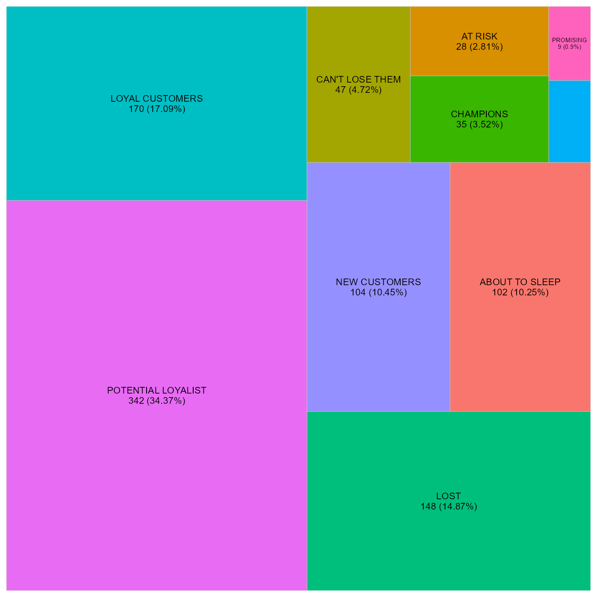
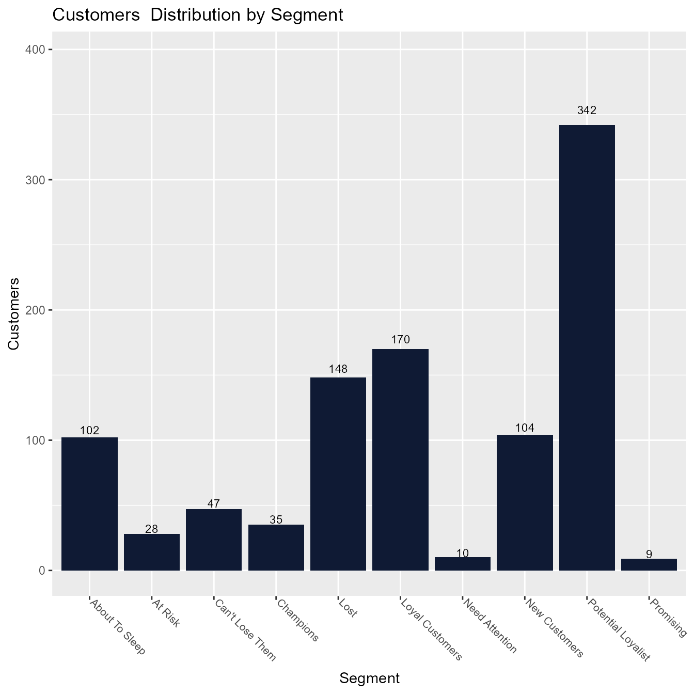
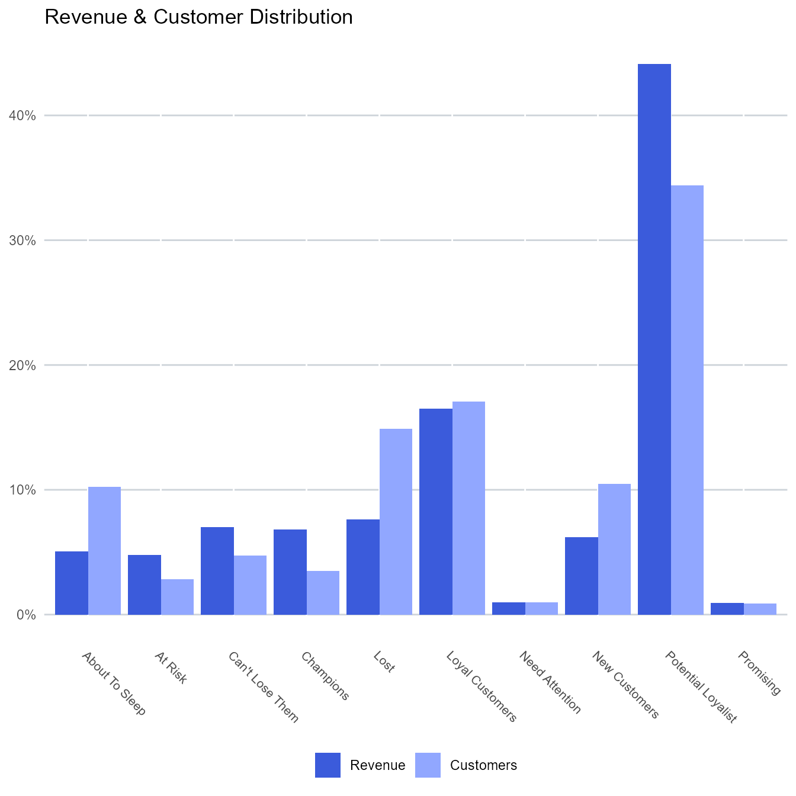

# RFM - Introduction

## Introduction

    ## Warning: package 'rlang' was built under R version 4.5.3

    ## Warning: package 'kableExtra' was built under R version 4.5.3

This article provides a brief introduction to RFM analysis and customer
segmentation. If you are looking for a detailed guide, check out our
free [online
course](https://rsquared-academy.thinkific.com/courses/customer-segmentation-using-rfm-analysis)
or YouTube [tutorial](https://www.youtube.com/watch?v=275X7yaSsoQ) or
blog
[post](https://blog.rsquaredacademy.com/customer-segmentation-using-rfm-analysis/).

**RFM** (recency, frequency, monetary) analysis is a behavior based
technique used to segment customers by examining their transaction
history such as

- how recently a customer has purchased (recency)
- how often they purchase (frequency)
- how much the customer spends (monetary)

It is based on the marketing axiom that **80% of your business comes
from 20% of your customers**. RFM helps to identify customers who are
more likely to respond to promotions by segmenting them into various
categories.

## Data

To calculate the RFM score for each customer we need data for a
particular time frame and should include the following:

- a unique customer id
- date of transaction/order
- transaction/order amount

Data can be at customer level or transaction level i.e. each row in the
data may represent a single transaction of a customer or summary of all
transactions of a customer. `rfm` package includes two sample data sets:

- `rfm_data_orders`

[`head`](https://rdrr.io/r/utils/head.html)`(``rfm_data_orders``)`

    ##        customer_id order_date revenue first_name last_name
    ## 1      Brion Stark 2004-12-20      32      Brion     Stark
    ## 2   Ethyl Botsford 2005-05-02      36      Ethyl  Botsford
    ## 3   Hosteen Jacobi 2004-03-06     116    Hosteen    Jacobi
    ## 4        Edw Frami 2006-03-15      99        Edw     Frami
    ## 5      Josef Lemke 2006-08-14      76      Josef     Lemke
    ## 6 Julisa Halvorson 2005-05-28      56     Julisa Halvorson
    ##                         email
    ## 1      brion_stark@rfmail.com
    ## 2   ethyl_botsford@rfmail.com
    ## 3   hosteen_jacobi@rfmail.com
    ## 4        edw_frami@rfmail.com
    ## 5      josef_lemke@rfmail.com
    ## 6 julisa_halvorson@rfmail.com

- `rfm_data_customer`

[`head`](https://rdrr.io/r/utils/head.html)`(``rfm_data_customer``)`

    ##   customer_id revenue most_recent_visit number_of_orders recency_days
    ## 1       22086     777        2006-05-14                9          232
    ## 2        2290    1555        2006-09-08               16          115
    ## 3       26377     336        2006-11-19                5           43
    ## 4       24650    1189        2006-10-29               12           64
    ## 5       12883    1229        2006-12-09               12           23
    ## 6        2119     929        2006-10-21               11           72
    ##   first_name last_name                  email
    ## 1  Maddalena      Erie          merie0@go.com
    ## 2    Bradley    Sesser      bsesser1@time.com
    ## 3    Gwenora     Asser      gasser2@issuu.com
    ## 4   Hendrick      Josh          hjosh3@ed.gov
    ## 5   Cathleen   Musterd    cmusterd4@hc360.com
    ## 6     Norrie     Brear nbrear5@techcrunch.com

You can take a look at them to understand the difference between
customer and transaction level data. **Remember, the data sets are
different and the final results will not match.**

## RFM Score

So how is the RFM score computed for each customer? The below steps
explain the process:

- A recency score is assigned to each customer based on date of most
  recent purchase. The score is generated by binning the recency values
  into a number of categories (default is 5). For example, if you use
  four categories, the customers with the most recent purchase dates
  receive a recency ranking of 4, and those with purchase dates in the
  distant past receive a recency ranking of 1.

- A frequency ranking is assigned in a similar way. Customers with high
  purchase frequency are assigned a higher score (4 or 5) and those with
  lowest frequency are assigned a score 1.

- Monetary score is assigned on the basis of the total revenue generated
  by the customer in the period under consideration for the analysis.
  Customers with highest revenue/order amount are assigned a higher
  score while those with lowest revenue are assigned a score of 1.

- A fourth score, RFM score is generated which is simply the three
  individual scores concatenated into a single value.

The customers with the highest RFM scores are most likely to respond to
an offer. Now that we have understood how the RFM score is computed, it
is time to put it into practice. Use
[`rfm_table_order()`](https://rfm.rsquaredacademy.com/reference/rfm_table_order.md)
to generate the score for each customer from the sample data set
`rfm_data_orders`.

`analysis_date`` ``<-`` `[`as.Date`](https://rdrr.io/r/base/as.Date.html)`(``"2006-12-31"``)`` ``rfm_result`` ``<-`` `[`rfm_table_order`](https://rfm.rsquaredacademy.com/reference/rfm_table_order.md)`(``rfm_data_orders``, ``customer_id``, ``order_date``, ``revenue``, ``analysis_date``)`` ``rfm_result`

| customer_id | recency_days | transaction_count | amount | rfm_score | recency_score | frequency_score | monetary_score | first_name | last_name | email |
|:---|---:|---:|---:|---:|---:|---:|---:|:---|:---|:---|
| Abbey O’Reilly | 205 | 6 | 472 | 343 | 3 | 4 | 3 | Abbey | O’Reilly | <abbey_o'reilly@rfmail.com> |
| Add Senger | 140 | 3 | 340 | 412 | 4 | 1 | 2 | Add | Senger | <add_senger@rfmail.com> |
| Aden Lesch | 194 | 4 | 405 | 323 | 3 | 2 | 3 | Aden | Lesch | <aden_lesch@rfmail.com> |
| Aden Murphy | 98 | 7 | 596 | 544 | 5 | 4 | 4 | Aden | Murphy | <aden_murphy@rfmail.com> |
| Admiral Senger | 132 | 5 | 448 | 433 | 4 | 3 | 3 | Admiral | Senger | <admiral_senger@rfmail.com> |
| Agness O’Keefe | 90 | 9 | 843 | 555 | 5 | 5 | 5 | Agness | O’Keefe | <agness_o'keefe@rfmail.com> |
| Aileen Barton | 84 | 9 | 763 | 555 | 5 | 5 | 5 | Aileen | Barton | <aileen_barton@rfmail.com> |
| Ailene Hermann | 281 | 8 | 699 | 355 | 3 | 5 | 5 | Ailene | Hermann | <ailene_hermann@rfmail.com> |
| Aiyanna Bruen | 246 | 4 | 157 | 321 | 3 | 2 | 1 | Aiyanna | Bruen | <aiyanna_bruen@rfmail.com> |
| Akeelah Walsh | 160 | 7 | 779 | 445 | 4 | 4 | 5 | Akeelah | Walsh | <akeelah_walsh@rfmail.com> |

## Segments

Let us segment our customers based on the individual recency, frequency
and monetary scores. Keep in mind that creating segments based on RFM
score is a very subjective endeavour. Having good business and domain
knowledge will allow the user to generate effective segments. There is
no one size fits all solution here.

| Segment | Description | R | F | M |
|:---|:---|:---|:---|:---|
| Champions | Bought recently, buy often and spend the most | 5 | 5 | 5 |
| Potential Loyalist | Recent customers, spent good amount, bought more than once | 3 - 5 | 3 - 5 | 2 - 5 |
| Loyal Customers | Spend good money. Responsive to promotions | 2 - 4 | 2 - 4 | 2 - 4 |
| Promising | Recent shoppers, but haven’t spent much | 3 - 4 | 1 - 3 | 3 - 5 |
| New Customers | Bought more recently, but not often | 4 - 5 | 1 - 3 | 1 - 5 |
| Can’t Lose Them | Made big purchases and often, but long time ago | 1 - 2 | 3 - 4 | 4 - 5 |
| At Risk | Spent big money, purchased often but long time ago | 1 - 2 | 2 - 5 | 4 - 5 |
| Need Attention | Above average recency, frequency & monetary values | 1 - 3 | 3 - 5 | 3 - 5 |
| About To Sleep | Below average recency, frequency & monetary values | 2 - 3 | 1 - 3 | 1 - 4 |
| Lost | Bought a long time ago, average amount spent | 1 - 1 | 1 - 5 | 1 - 5 |

## Segmented Customer Data

We can use the segmented data to identify

- best customers
- loyal customers
- at risk customers
- and lost customers

Once we have segmented a customer, we can take appropriate action to
increase his/her lifetime value.

| customer_id | segment | rfm_score | transaction_count | recency_days | amount | recency_score | frequency_score | monetary_score | first_name | last_name | email |
|:---|:---|---:|---:|---:|---:|---:|---:|---:|:---|:---|:---|
| Abbey O’Reilly | Potential Loyalist | 343 | 6 | 205 | 472 | 3 | 4 | 3 | Abbey | O’Reilly | <abbey_o'reilly@rfmail.com> |
| Add Senger | New Customers | 412 | 3 | 140 | 340 | 4 | 1 | 2 | Add | Senger | <add_senger@rfmail.com> |
| Aden Lesch | Loyal Customers | 323 | 4 | 194 | 405 | 3 | 2 | 3 | Aden | Lesch | <aden_lesch@rfmail.com> |
| Aden Murphy | Potential Loyalist | 544 | 7 | 98 | 596 | 5 | 4 | 4 | Aden | Murphy | <aden_murphy@rfmail.com> |
| Admiral Senger | Potential Loyalist | 433 | 5 | 132 | 448 | 4 | 3 | 3 | Admiral | Senger | <admiral_senger@rfmail.com> |
| Agness O’Keefe | Champions | 555 | 9 | 90 | 843 | 5 | 5 | 5 | Agness | O’Keefe | <agness_o'keefe@rfmail.com> |
| Aileen Barton | Champions | 555 | 9 | 84 | 763 | 5 | 5 | 5 | Aileen | Barton | <aileen_barton@rfmail.com> |
| Ailene Hermann | Potential Loyalist | 355 | 8 | 281 | 699 | 3 | 5 | 5 | Ailene | Hermann | <ailene_hermann@rfmail.com> |
| Aiyanna Bruen | About To Sleep | 321 | 4 | 246 | 157 | 3 | 2 | 1 | Aiyanna | Bruen | <aiyanna_bruen@rfmail.com> |
| Akeelah Walsh | Potential Loyalist | 445 | 7 | 160 | 779 | 4 | 4 | 5 | Akeelah | Walsh | <akeelah_walsh@rfmail.com> |

Let us quickly summarize the segments to get an overview of the number
of customers, orders and average order value in each of them.

#### Segment Summary

[`rfm_segment_summary`](https://rfm.rsquaredacademy.com/reference/rfm_segment_summary.md)`(``segments``)`

    ## # A tibble: 10 × 5
    ##    segment            customers orders revenue   aov
    ##    <chr>                  <int>  <int>   <int> <dbl>
    ##  1 About To Sleep           102    283   23449  82.9
    ##  2 At Risk                   28    216   22227 103. 
    ##  3 Can't Lose Them           47    274   32446 118. 
    ##  4 Champions                 35    316   31646 100. 
    ##  5 Lost                     148    393   35324  89.9
    ##  6 Loyal Customers          170    799   76562  95.8
    ##  7 Need Attention            10     57    4562  80.0
    ##  8 New Customers            104    329   28837  87.6
    ##  9 Potential Loyalist       342   2211  204856  92.6
    ## 10 Promising                  9     28    4249 152.

`rfm` package offers visualization tools to validate the segments
generated from the RFM score. Below are a few of them:

#### Segmentation Plot

`segments`` ``%>%`` `` `[`rfm_segment_summary`](https://rfm.rsquaredacademy.com/reference/rfm_segment_summary.md)`(``)`` ``%>%`` `` `[`rfm_plot_segment`](https://rfm.rsquaredacademy.com/reference/rfm_plot_segment.md)`(``)`

#### Segment Summary Plot

`segments`` ``%>%`` `` `[`rfm_segment_summary`](https://rfm.rsquaredacademy.com/reference/rfm_segment_summary.md)`(``)`` ``%>%`` `` `[`rfm_plot_segment_summary`](https://rfm.rsquaredacademy.com/reference/rfm_plot_segment_summary.md)`(``)`

#### Revenue Distribution

`segments`` ``%>%`` `` `[`rfm_segment_summary`](https://rfm.rsquaredacademy.com/reference/rfm_segment_summary.md)`(``)`` ``%>%`` `` `[`rfm_plot_revenue_dist`](https://rfm.rsquaredacademy.com/reference/rfm_plot_revenue_dist.md)`(``)`

