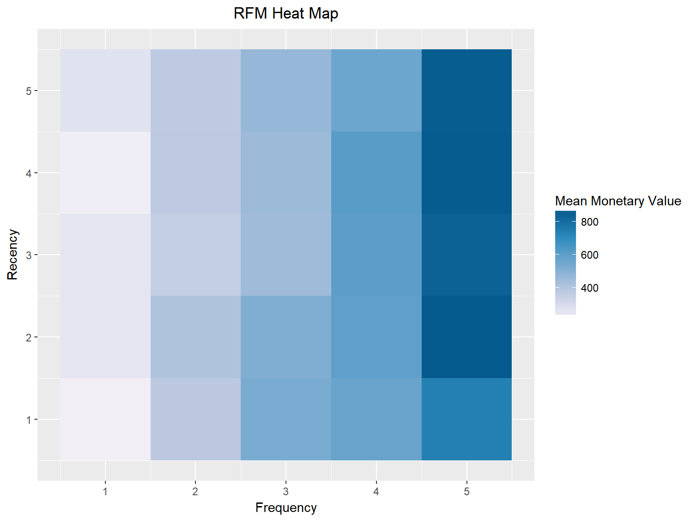
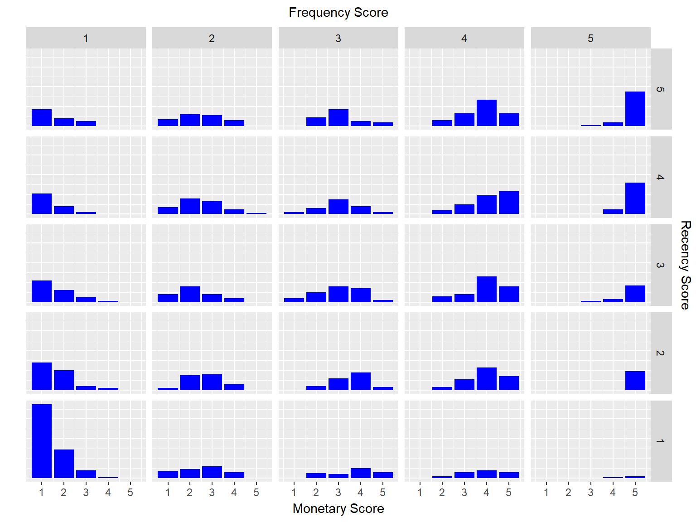
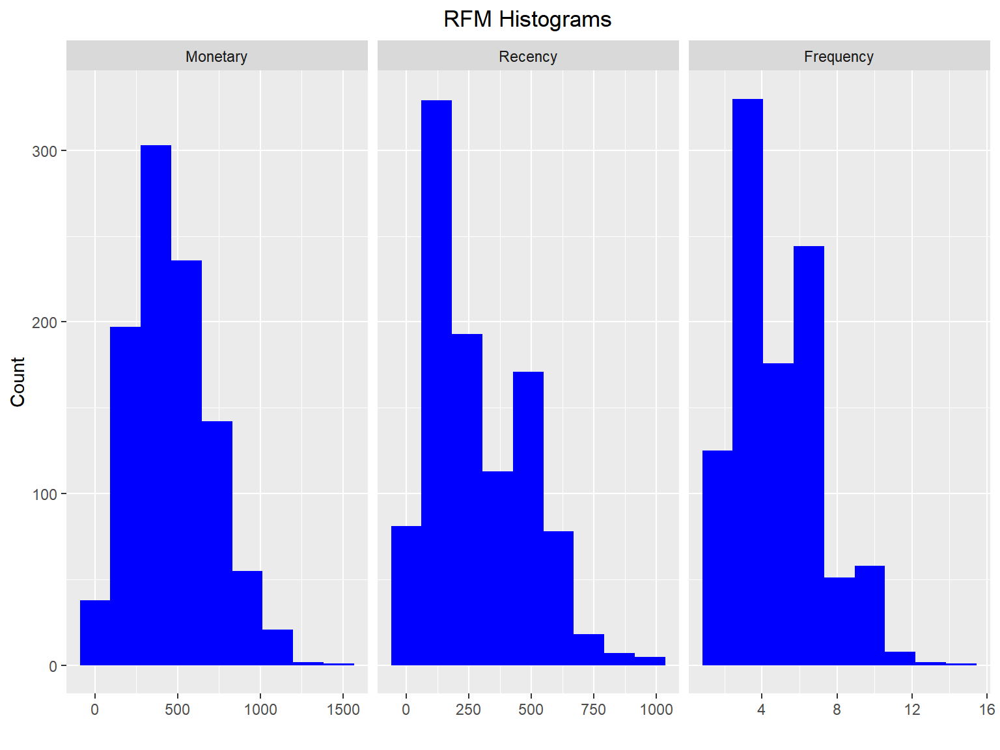
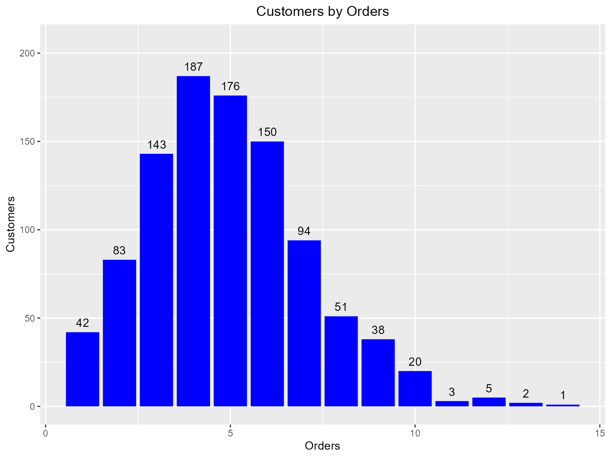
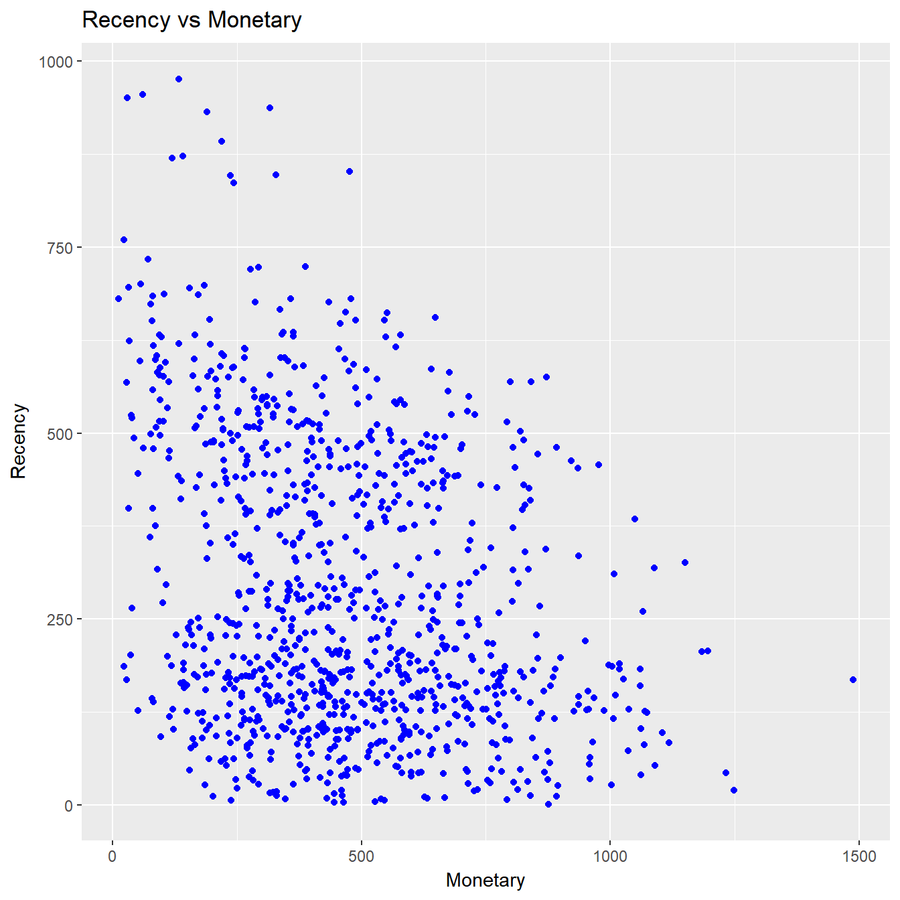
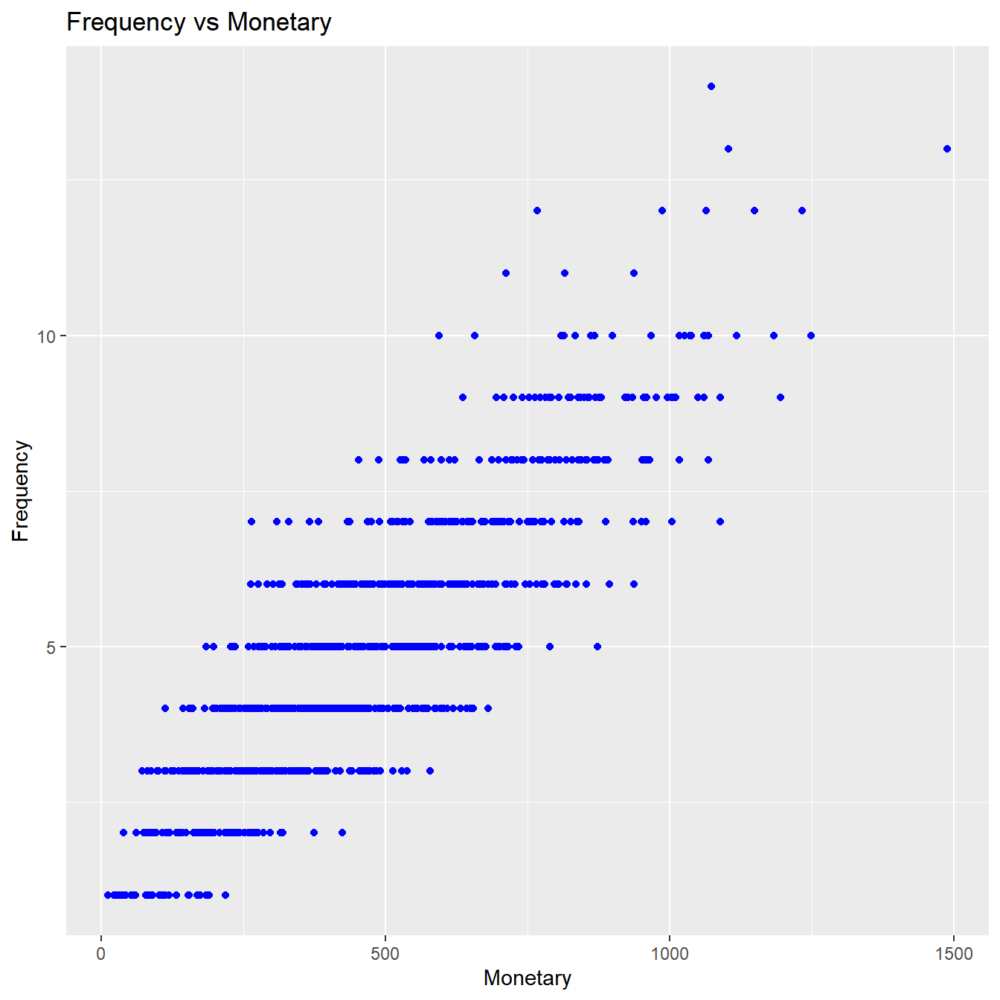
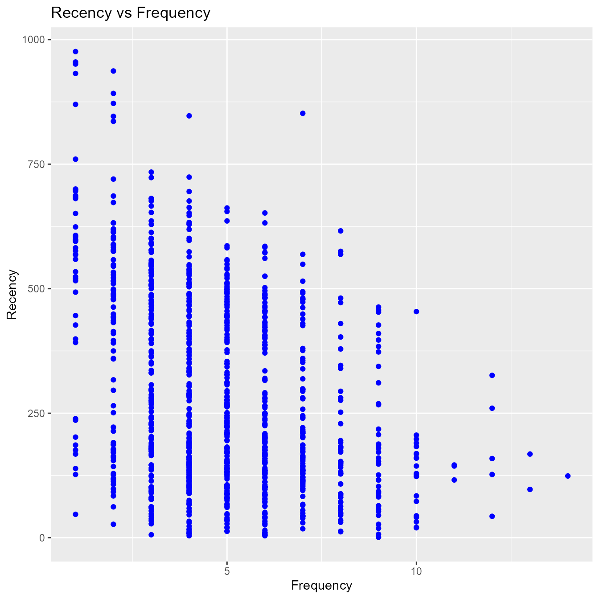
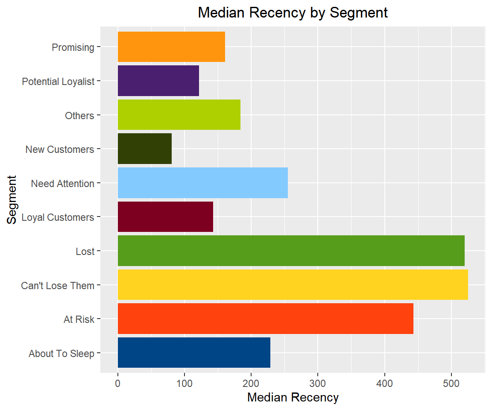
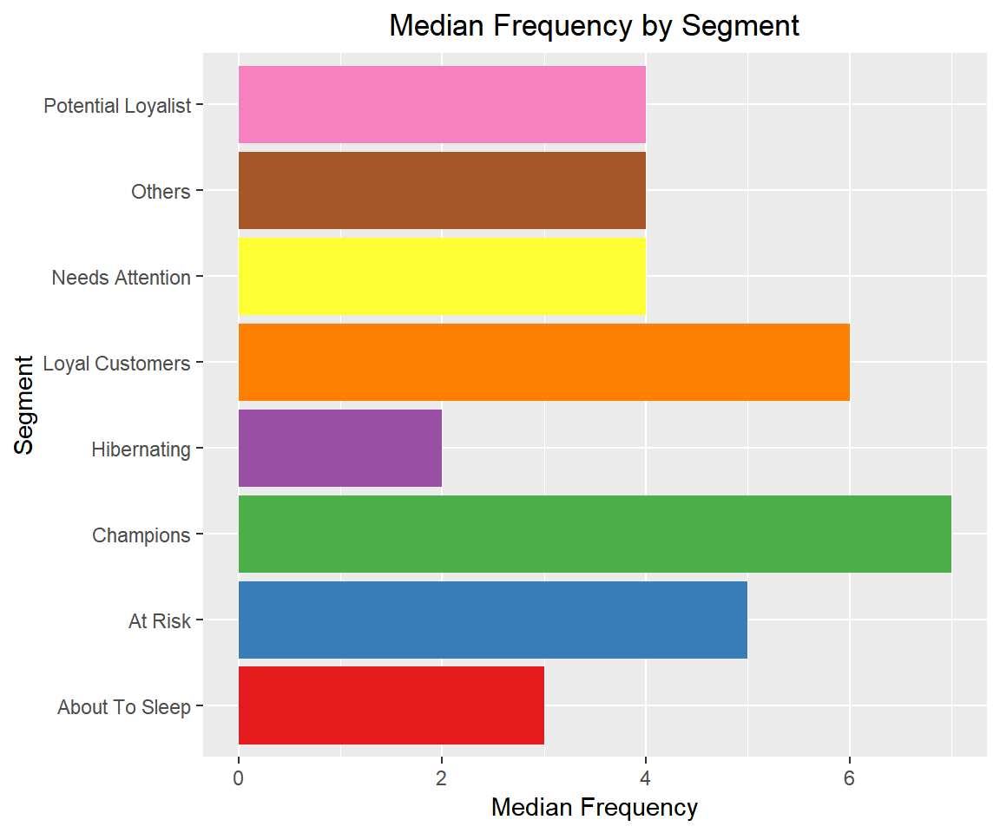
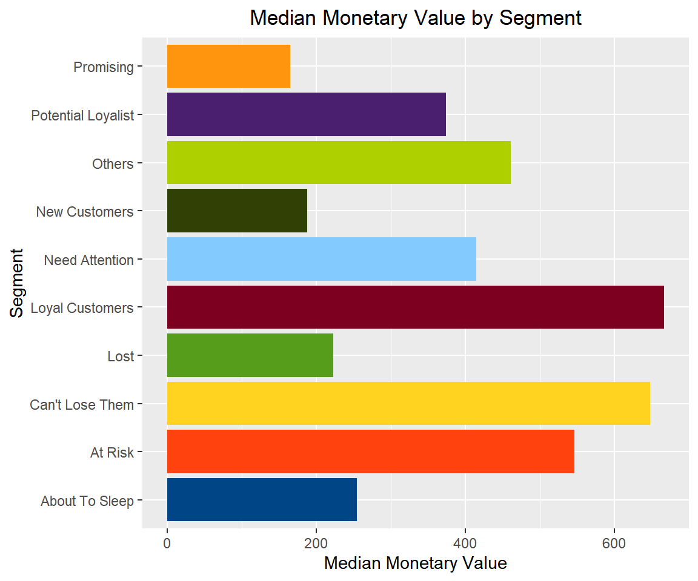

# RFM - Transaction Level Data

## Introduction

**RFM** (recency, frequency, monetary) analysis is a behavior based
technique used to segment customers by examining their transaction
history such as

- how recently a customer has purchased (recency)
- how often they purchase (frequency)
- how much the customer spends (monetary)

It is based on the marketing axiom that **80% of your business comes
from 20% of your customers**. RFM helps to identify customers who are
more likely to respond to promotions by segmenting them into various
categories.

## Data

To calculate the RFM score for each customer we need transaction data
which should include the following:

- a unique customer id
- date of transaction/order
- transaction/order amount

`rfm` includes a sample data set `rfm_data_orders` which includes the
above details:

`rfm_data_orders`

    ## # A tibble: 4,906 x 3
    ##    customer_id         order_date revenue
    ##    <chr>               <date>       <dbl>
    ##  1 Mr. Brion Stark Sr. 2004-12-20      32
    ##  2 Ethyl Botsford      2005-05-02      36
    ##  3 Hosteen Jacobi      2004-03-06     116
    ##  4 Mr. Edw Frami       2006-03-15      99
    ##  5 Josef Lemke         2006-08-14      76
    ##  6 Julisa Halvorson    2005-05-28      56
    ##  7 Judyth Lueilwitz    2005-03-09     108
    ##  8 Mr. Mekhi Goyette   2005-09-23     183
    ##  9 Hansford Moen PhD   2005-09-07      30
    ## 10 Fount Flatley       2006-04-12      13
    ## # i 4,896 more rows

## RFM Score

So how is the RFM score computed for each customer? The below steps
explain the process:

- A recency score is assigned to each customer based on date of most
  recent purchase. The score is generated by binning the recency values
  into a number of categories (default is 5). For example, if you use
  four categories, the customers with the most recent purchase dates
  receive a recency ranking of 4, and those with purchase dates in the
  distant past receive a recency ranking of 1.

- A frequency ranking is assigned in a similar way. Customers with high
  purchase frequency are assigned a higher score (4 or 5) and those with
  lowest frequency are assigned a score 1.

- Monetary score is assigned on the basis of the total revenue generated
  by the customer in the period under consideration for the analysis.
  Customers with highest revenue/order amount are assigned a higher
  score while those with lowest revenue are assigned a score of 1.

- A fourth score, RFM score is generated which is simply the three
  individual scores concatenated into a single value.

The customers with the highest RFM scores are most likely to respond to
an offer. Now that we have understood how the RFM score is computed, it
is time to put it into practice. Use
[`rfm_table_order()`](https://rfm.rsquaredacademy.com/reference/rfm_table_order.md)
to generate the score for each customer from the sample data set
`rfm_data_orders`.

[`rfm_table_order()`](https://rfm.rsquaredacademy.com/reference/rfm_table_order.md)
takes 8 inputs:

- `data`: a data set with
  - unique customer id
  - date of transaction
  - and amount
- `customer_id`: name of the customer id column
- `order_date`: name of the transaction date column
- `revenue`: name of the transaction amount column
- `analysis_date`: date of analysis
- `recency_bins`: number of rankings for recency score (default is 5)
- `frequency_bins`: number of rankings for frequency score (default is
  5)
- `monetary_bins`: number of rankings for monetary score (default is 5)

## RFM Table

`analysis_date`` ``<-`` `[`as.Date`](https://rdrr.io/r/base/as.Date.html)`(``"2006-12-31"``)`` ``rfm_result`` ``<-`` `[`rfm_table_order`](https://rfm.rsquaredacademy.com/reference/rfm_table_order.md)`(``rfm_data_orders``, ``customer_id``, ``order_date``, ``revenue``, ``analysis_date``)`` ``rfm_result`

| customer_id | recency_days | transaction_count | amount | recency_score | frequency_score | monetary_score | rfm_score |
|:---|---:|---:|---:|---:|---:|---:|---:|
| Mr. Brion Stark Sr.  | 229 | 8 | 852 | 3 | 5 | 5 | 355 |
| Ethyl Botsford | 252 | 8 | 526 | 3 | 5 | 4 | 354 |
| Hosteen Jacobi | 545 | 4 | 300 | 1 | 2 | 2 | 122 |
| Mr. Edw Frami | 44 | 10 | 868 | 5 | 5 | 5 | 555 |
| Josef Lemke | 48 | 5 | 391 | 5 | 3 | 3 | 533 |
| Julisa Halvorson | 127 | 12 | 987 | 4 | 5 | 5 | 455 |
| Judyth Lueilwitz | 662 | 5 | 552 | 1 | 3 | 4 | 134 |
| Mr. Mekhi Goyette | 416 | 4 | 350 | 2 | 2 | 2 | 222 |
| Hansford Moen PhD | 186 | 7 | 1004 | 3 | 4 | 5 | 345 |
| Fount Flatley | 146 | 11 | 937 | 4 | 5 | 5 | 455 |

[`rfm_table_order()`](https://rfm.rsquaredacademy.com/reference/rfm_table_order.md)
will return the following columns as seen in the above table:

- `customer_id`: unique customer id
- `date_most_recent`: date of most recent visit
- `recency_days`: days since the most recent visit
- `transaction_count`: number of transactions of the customer
- `amount`: total revenue generated by the customer
- `recency_score`: recency score of the customer
- `frequency_score`: frequency score of the customer
- `monetary_score`: monetary score of the customer
- `rfm_score`: RFM score of the customer

## Heat Map

The heat map shows the average monetary value for different categories
of recency and frequency scores. Higher scores of frequency and recency
are characterized by higher average monetary value as indicated by the
darker areas in the heatmap.

[`rfm_plot_heatmap`](https://rfm.rsquaredacademy.com/reference/rfm_plot_heatmap.md)`(``rfm_result``)`

## Bar Chart

Use
[`rfm_bar_chart()`](https://rfm.rsquaredacademy.com/reference/rfm_plot_bar_chart.md)
to generate the distribution of monetary scores for the different
combinations of frequency and recency scores.

[`rfm_plot_bar_chart`](https://rfm.rsquaredacademy.com/reference/rfm_plot_bar_chart.md)`(``rfm_result``)`

## Histogram

Use
[`rfm_histograms()`](https://rfm.rsquaredacademy.com/reference/rfm_plot_histograms.md)
to examine the relative distribution of

- monetary value (total revenue generated by each customer)
- recency days (days since the most recent visit for each customer)
- frequency (transaction count for each customer)

[`rfm_plot_histograms`](https://rfm.rsquaredacademy.com/reference/rfm_plot_histograms.md)`(``rfm_result``)`

## Customers by Orders

Visualize the distribution of customers across orders.

[`rfm_plot_order_dist`](https://rfm.rsquaredacademy.com/reference/rfm_plot_order_dist.md)`(``rfm_result``)`

## Segments

Let us classify our customers based on the individual recency, frequency
and monetary scores.

| Segment | Description | R | F | M |
|:---|:---|:---|:---|:---|
| Champions | Bought recently, buy often and spend the most | 5 | 5 | 5 |
| Potential Loyalist | Recent customers, spent good amount, bought more than once | 3 - 5 | 3 - 5 | 2 - 5 |
| Loyal Customers | Spend good money. Responsive to promotions | 2 - 4 | 2 - 4 | 2 - 4 |
| Promising | Recent shoppers, but haven’t spent much | 3 - 4 | 1 - 3 | 3 - 5 |
| New Customers | Bought more recently, but not often | 4 - 5 | 1 - 3 | 1 - 5 |
| Can’t Lose Them | Made big purchases and often, but long time ago | 1 - 2 | 3 - 4 | 4 - 5 |
| At Risk | Spent big money, purchased often but long time ago | 1 - 2 | 2 - 5 | 4 - 5 |
| Need Attention | Above average recency, frequency & monetary values | 1 - 3 | 3 - 5 | 3 - 5 |
| About To Sleep | Below average recency, frequency & monetary values | 2 - 3 | 1 - 3 | 1 - 4 |
| Lost | Bought a long time ago, average amount spent | 1 - 1 | 1 - 5 | 1 - 5 |

## Segmented Customer Data

We can use the segmented data to identify

- best customers
- loyal customers
- at risk customers
- and lost customers

Once we have classified a customer into a particular segment, we can
take appropriate action to increase his/her lifetime value.

## Segment Size

Now that we have defined and segmented our customers, let us examine the
distribution of customers across the segments. Ideally, we should have
very few or no customer in segments such as `At Risk` or
`Needs Attention`.

    ##               Segment Count
    ## 1  Potential Loyalist   342
    ## 2     Loyal Customers   170
    ## 3                Lost   148
    ## 4       New Customers   104
    ## 5      About To Sleep   102
    ## 6     Can't Lose Them    47
    ## 7           Champions    35
    ## 8             At Risk    28
    ## 9      Need Attention    10
    ## 10          Promising     9

## Scatter Plots

The best customers are those who:

- bought most recently
- most often
- and spend the most

Now let us examine the relationship between the above.

#### Recency vs Monetary Value

Customers who visited more recently generated more revenue compared to
those who visited in the distant past. The customers who visited in the
recent past are more likely to return compared to those who visited long
time ago as most of those would be lost customers. As such, higher
revenue would be associated with most recent visits.

[`rfm_plot_segment_scatter`](https://rfm.rsquaredacademy.com/reference/rfm_plot_segment_scatter.md)`(``segments``, ``"monetary"``, ``"recency"``)`

#### Frequency vs Monetary Value

As the frequency of visits increases, the revenue generated also
increases. Customers who visit more frquently are your champion
customers, loyal customers or potential loyalists and they drive higher
revenue.

[`rfm_plot_segment_scatter`](https://rfm.rsquaredacademy.com/reference/rfm_plot_segment_scatter.md)`(``segments``, ``"monetary"``, ``"frequency"``)`

#### Recency vs Frequency

Customers with low frequency visited in the distant past while those
with high frequency have visited in the recent past. Again, the
customers who visited in the recent past are more likely to return
compared to those who visited long time ago. As such, higher frequency
would be associated with the most recent visits.

[`rfm_plot_segment_scatter`](https://rfm.rsquaredacademy.com/reference/rfm_plot_segment_scatter.md)`(``segments``, ``"frequency"``, ``"recency"``)`

We can also examine the median recency, frequency and monetary value
across segments to ensure that the logic used for customer
classification is sound and practical.

### Median Recency

[`rfm_plot_median_recency`](https://rfm.rsquaredacademy.com/reference/rfm_plot_median_recency.md)`(``segments``)`

### Median Frequency

[`rfm_plot_median_frequency`](https://rfm.rsquaredacademy.com/reference/rfm_plot_median_recency.md)`(``segments``)`

### Median Monetary Value

[`rfm_plot_median_monetary`](https://rfm.rsquaredacademy.com/reference/rfm_plot_median_recency.md)`(``segments``)`

## References

- Data Mining: Concepts and Techniques , Second Edition , Jiawei Han
  University of Illinois at Urbana-Champaign Micheline Kamber.
- <https://joaocorreia.io/blog/rfm-analysis-increase-sales-by-segmenting-your-customers.html>
- <https://www.sciencedirect.com/science/article/pii/S1877050910003868>
